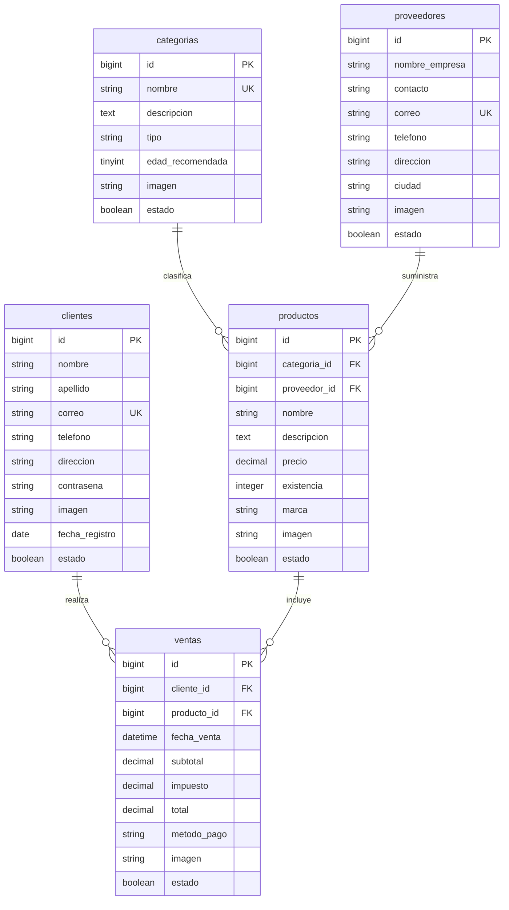

# Diagrama relacional: tienda de productos coleccionables

Las tablas del proyecto son `clientes`, `categorias`, `productos`, `proveedores` y `ventas`.
Las claves primarias se llaman `id`; las claves foráneas usan el patrón
`nombre_singular_id`. Todas las relaciones usan eliminación restringida y actualización
en cascada.



## Migración y conexión

La configuración de desarrollo usa SQLite (`DB_CONNECTION=sqlite`). Para recrear la base
de datos y ejecutar todas las migraciones:

```bash
php artisan migrate:fresh --force
```

Para comprobar la conexión y el estado de las migraciones:

```bash
php artisan migrate:status
php artisan about
```

> Este esquema conserva las tablas técnicas de Laravel para sesiones, caché y trabajos.
> No forman parte del modelo de negocio.

## Nota de normalización

La lista solicitada contiene cinco tablas y por ello `ventas` tiene `producto_id`. Si una
venta debe contener varios productos, el diseño relacional recomendado agrega
`productos_ventas` con `venta_id`, `producto_id`, `cantidad` y `precio`; esa tabla sería
una ampliación posterior del esquema de cinco tablas.